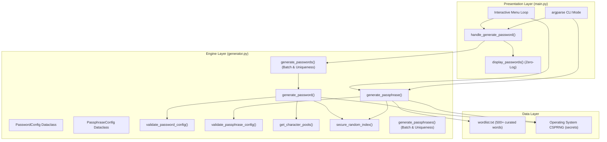

# CS50x Final Project: Secure CLI Password & Passphrase Generator

## Project Overview

A cryptographically secure command-line password and passphrase generation tool written in Python 3. Designed as a final project submission for Harvard's **CS50x: Introduction to Computer Science**, this tool adheres to rigorous cryptographic best practices, software engineering principles, and a zero-retention security model.

The tool provides both an intuitive interactive terminal menu and a scriptable CLI interface powered by `argparse`. It generates complex random passwords with strict character class guarantees and Diceware-style multi-word passphrases with optional separators, capitalization, and suffixes.

---

## Features

### 1. Cryptographically Secure Random Password Generation
- **Configurable Length**: User-definable password length.
- **Granular Character Pools**: Toggle uppercase letters (`A-Z`), lowercase letters (`a-z`), digits (`0-9`), and special symbols (`!@#$%^&*...`).
- **Character Class Representation Guarantee**: Ensures that if a character class is enabled, at least one character from that class will appear in the output.
- **Ambiguous Character Filtering**: Eliminates visually confusing characters (`0`, `O`, `1`, `l`, `I`, `|`) to prevent transcription errors in terminals and printed documents.
- **Batch Generation & Uniqueness**: Generate multiple passwords in a single run with duplicate detection. If uniqueness cannot be achieved due to pool or length limits, reports the limitation cleanly.

### 2. Multi-Word Passphrase Generation
- **Configurable Word Count**: Choose the number of words (e.g., 4 to 8 words).
- **Custom Separators**: Use any delimiter (e.g., `-`, `_`, `.`, or spaces).
- **Casing & Suffix Customization**: Toggle TitleCase capitalization and optional random numeric or special character suffixes.
- **Bundled Wordlist**: Includes a curated dictionary of clean, distinct, lowercase English words (`wordlist.txt`) inspired by EFF Diceware lists.
- **Output Length Validation**: Pre-validates minimal theoretical length before assembling passphrases.

### 3. Command-Line Interface (Interactive & Scriptable)
- **Interactive Menu**: A numbered menu (Generate Password, Generate Passphrase, Change Settings, Exit).
- **CLI Flag Support**: Run one-shot generation using `argparse` flags (e.g., `--mode password --length 24 -n 3`).
- **Graceful Error & Signal Handling**: Handles `KeyboardInterrupt` (Ctrl+C), `EOFError` (Ctrl+D / Ctrl+Z), and invalid inputs without ugly stack traces.
- **Zero-Log Security Policy**: Passwords are displayed exclusively on standard output and never saved to disk, temp files, or logs.

---

## Cryptographically Secure Randomness: `secrets` vs `random`

In cybersecurity, passwords and cryptographic keys must be unpredictable. Python's standard `random` module uses the **Mersenne Twister** algorithm (MT19937), which is designed for statistical simulations and speed, **not security**:
- Mersenne Twister is deterministic: observing 624 consecutive 32-bit outputs allows an attacker to reconstruct its internal state and predict every future "random" value.
- In contrast, Python's `secrets` module accesses operating system-level entropy sources:
  - Windows: `BCryptGenRandom` / `CryptGenRandom`
  - Linux/Unix: `getrandom()` / `/dev/urandom`
  - macOS: `getentropy()`
- These sources are **Cryptographically Secure Pseudo-Random Number Generators (CSPRNG)** designed to resist state-compromise and prediction attacks.

> [!IMPORTANT]
> This application strictly avoids `random` and sources all entropy from `secrets` (`secrets.randbelow`, `secrets.choice`, `secrets.SystemRandom`).

---

## Architecture and Design Decisions

The project is structured into distinct, modular layers following the separation of concerns:

```
password-generator/
├── main.py               # Presentation layer & CLI / Interactive UI
├── generator.py          # Domain logic & cryptographic generation engine
├── wordlist.txt          # Bundled clean English wordlist for passphrases
├── tests/
│   └── test_generator.py # Comprehensive unittest test suite
└── README.md             # Project documentation & CS50x disclosure
```



### Key Architectural Choices:
1. **Immutable-Style Dataclasses**: `PasswordConfig` and `PassphraseConfig` represent immutable setting snapshots, avoiding mutable global state.
2. **Defensive Validation First**: Validation functions (`validate_password_config`, `validate_passphrase_config`) run before any random selections occur.
3. **Stateless Functions**: Pure, testable functions allow unit testing of core generation logic independently of UI inputs.
4. **Infinite Loop Prevention**: Batch generators implement an attempt counter ($15 \times \text{count}$) to prevent hanging when user requests high counts from small pools.

---

## Setup & Execution

### Prerequisites
- Python 3.8 or higher.
- No third-party packages required (uses Python standard library only).

### Running Interactive Mode
From the workspace root directory:
```bash
python password-generator/main.py
```
Or navigate into `password-generator`:
```bash
cd password-generator
python main.py
```

### Running Non-Interactive CLI Mode
Generate a 20-character password:
```bash
python password-generator/main.py --mode password --length 20
```

Generate 3 passwords excluding special characters and ambiguous symbols:
```bash
python password-generator/main.py --mode password --length 16 --no-special -n 3
```

Generate a 5-word passphrase with an underscore separator and capitalized words:
```bash
python password-generator/main.py --mode passphrase --words 5 --separator "_" --capitalize
```

Generate a passphrase with an appended numeric and symbol suffix:
```bash
python password-generator/main.py --mode passphrase --words 4 --add-number --add-symbol
```

---

## Testing

A comprehensive `unittest` test suite is provided in `tests/test_generator.py`.

### Running All Tests
```bash
python -m unittest discover -s password-generator/tests -p "test_*.py"
```

### Test Suite Status
All 33 tests pass: `Ran 33 tests ... OK`.

---

## Known Limitations

1. **Entropy Upper Bound in Small Wordlists**:
   The bundled `wordlist.txt` contains 500+ common English words ($\approx 9$ bits of entropy per word). For production master passphrases requiring $> 100$ bits of entropy, a 7,776-word EFF long wordlist is recommended.
2. **Batch Uniqueness with Very Short Lengths**:
   If a user requests 50 unique passwords of length 3 using only digits ($10^3 = 1000$ possibilities), collision probability is noticeable; the generator caps attempts to prevent infinite loops and informs the user if uniqueness cannot be guaranteed.

---

## CS50 Academic Honesty & AI Assistance Disclosure

In compliance with the Harvard CS50 Academic Honesty policy regarding AI assistance, AI was used for the following parts of this project:

- Overall project architecture and directory scaffolding.
- Interactive CLI menus, input validation loops, and signal handling in `main.py`.
- Configuration dataclasses (`PasswordConfig`, `PassphraseConfig`).
- Wordlist loader and character pool helper functions in `generator.py`.
- Curated wordlist (`wordlist.txt`).
- Unit test framework and test cases in `tests/test_generator.py`.
- Documentation (`README.md`).
- Core algorithms: `secure_random_index`, `validate_password_config`, `generate_password`, `generate_passphrase` (`generator.py`) and `handle_generate_password` (`main.py`).
